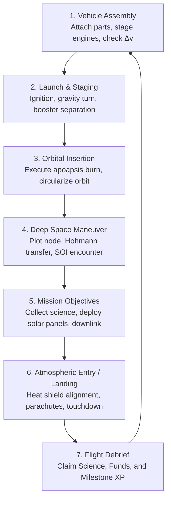
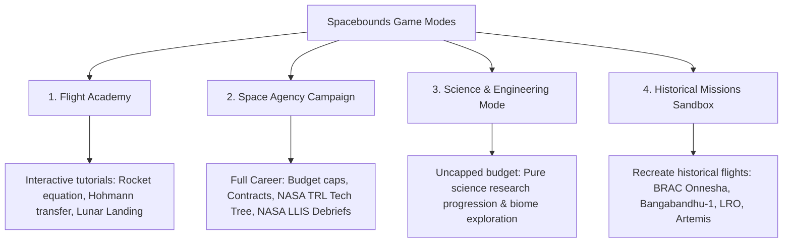
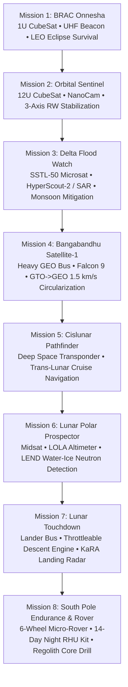
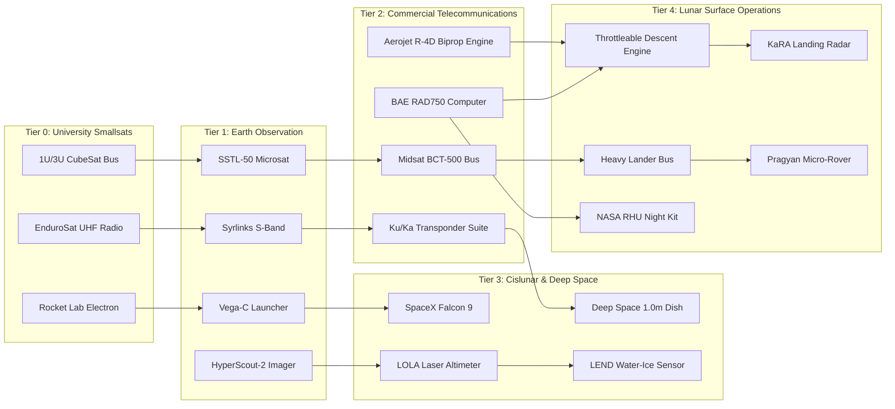

# Spacebounds: Kerbal Space Program Research & Game Requirements Document (GRD)
**Project Codename:** Spacebounds  
**Version:** 1.0.0 (Master Game Design & Requirements Specification)  
**Author / Role:** Lead Game Designer  
**Status:** Approved for Implementation  
**Target Engines / Platforms:** Unity 6 / Godot 4 / Unreal Engine 5 (Desktop PC / WebGL / Educational Simulation)

---

## Table of Contents
1. [Executive Summary & Vision Statement](#1-executive-summary--vision-statement)
2. [Deep Research: Kerbal Space Program (KSP) Reverse-Engineered](#2-deep-research-kerbal-space-program-ksp-reverse-engineered)
   - 2.1 The Core Gameplay Philosophy ("Failure is Fun")
   - 2.2 The KSP Dual-Loop Architecture (Micro vs. Macro)
   - 2.3 Game Modes Taxonomy
   - 2.4 Vehicle Assembly Building (VAB) & Structural Mechanics
   - 2.5 Orbital Mechanics & Astrodynamics Engine
   - 2.6 The NavBall & Flight Navigation Vector UI
   - 2.7 Atmospheric, Aerodynamic & Thermal Simulation
   - 2.8 Subsystem Resource Management
   - 2.9 Communication & Network Topology (CommNet)
   - 2.10 Science Collection, Biome Matrices & Research Labs
   - 2.11 Contracts, Milestones & Agency Economy
   - 2.12 Resource Extraction & In-Situ Resource Utilization (ISRU)
3. [Spacebounds: Core Gameplay Adaptation & Distinct Identity](#3-spacebounds-core-gameplay-adaptation--distinct-identity)
   - 3.1 The Spacebounds Identity: Real Hardware Meets KSP Agency
   - 3.2 Game Modes in Spacebounds
   - 3.3 The NASA Project Lifecycle Core Game Loop (Phases A–F)
4. [Functional Requirements: Vehicle Assembly & Engineering Workshop](#4-functional-requirements-vehicle-assembly--engineering-workshop)
   - 4.1 Bus Platform & Structural Layout
   - 4.2 Dynamic Physical Overlays (CoM, CoT, Live Delta-V, TWR)
   - 4.3 Staging Sequence & Action Groups
   - 4.4 Automated Flight Readiness Review (FRR) Linter
5. [Functional Requirements: Orbital Simulation & Flight Mechanics](#5-functional-requirements-orbital-simulation--flight-mechanics)
   - 5.1 2-Body Patched Conics Engine
   - 5.2 Maneuver Node Planner & Trajectory Prediction
   - 5.3 NavBall & Attitude Guidance System (SAS)
   - 5.4 Atmospheric Flight, Drag & Aerothermal Re-Entry
   - 5.5 Powered Descent & Precision Touchdown Autopilot
6. [Functional Requirements: Spacecraft Subsystems & Resource Engines](#6-functional-requirements-spacecraft-subsystems--resource-engines)
   - 6.1 Electrical Power Subsystem (EPS) & Eclipse Simulation
   - 6.2 Thermal Management Subsystem (MLI, Radiators, RHU)
   - 6.3 Telecommunications & Ground Station Line-of-Sight Network
   - 6.4 In-Space Propulsion & Propellant Dynamics
7. [Functional Requirements: Science, Payloads & Biome Architecture](#7-functional-requirements-science-payloads--biome-architecture)
   - 7.1 Scientific Payloads & Observation Instruments
   - 7.2 Celestial Body Situations & Biome Hierarchy
   - 7.3 Data Transmission vs. Physical Sample Return
8. [Functional Requirements: Missions, Dynamic Contracts & Milestones](#8-functional-requirements-missions-dynamic-contracts--milestones)
   - 8.1 8-Mission Historical Campaign (BRAC Onnesha to Lunar South Pole)
   - 8.2 Procedural Contract Generation Matrix
   - 8.3 "World's First" Milestone Tracking Engine
9. [Functional Requirements: In-Flight Events & NASA Lessons Learned](#9-functional-requirements-in-flight-events--nasa-lessons-learned)
   - 9.1 Dynamic Anomaly Engine & Testing Mitigations
   - 9.2 Real-Time Decision Trees & Mitigation Protocols
   - 9.3 Post-Flight Debrief & LLIS Citation System
10. [Functional Requirements: Achievements, Scoring & Progression](#10-functional-requirements-achievements-scoring--progression)
    - 10.1 Master Achievement Roster
    - 10.2 Quantitative Mission Scoring Formula
    - 10.3 Technology Readiness Level (TRL) Tech Tree Progression
11. [Technical Architecture & Data Specifications](#11-technical-architecture--data-specifications)
    - 11.1 Component-Based Software Architecture (ECS / GameObject)
    - 11.2 Double-Precision Coordinates & Floating Origin System
    - 11.3 Physics Tick vs. Time Warp Architecture
    - 11.4 Comprehensive Data Schemas (JSON)
12. [UI/UX Wireframe & Screen Flow Specifications](#12-uiux-wireframe--screen-flow-specifications)
13. [Implementation Roadmap & Milestones](#13-implementation-roadmap--milestones)

---

## 1. Executive Summary & Vision Statement

### 1.1 The Concept
**Spacebounds** is an engineering simulation and space exploration game that bridges the emergent spatial joy and trial-and-error mastery of **Kerbal Space Program (KSP)** with **authentic, flight-proven aerospace hardware**, real-world mission milestones (from Bangladesh’s pioneering **BRAC Onnesha** CubeSat and **Bangabandhu Satellite-1** to international **Lunar South Pole Artemis-era exploration**), and formal **NASA Systems Engineering principles (NASA NPR 7120.5)**.

### 1.2 The Core Problem with Existing Space Games
* **Kerbal Space Program (KSP 1 & 2):** Incredible physics playground, intuitive orbital mechanics, and modular assembly, but features fictional planets (Kerbin, Duna, Jool), cartoonish parts (Jebediah's junkyard engines), and lacks grounding in real satellite subsystems, space budgets, and authentic aerospace failure modes.
* **Hardcore Aerospace Tools (GMAT, STK, Orbiter):** Real physics and realistic components, but impenetrable UI, steep mathematical barriers, lack of gamification, no progression loops, and zero emergent entertainment value.

### 1.3 The Spacebounds Solution
Spacebounds delivers the **sweet spot**:
1. **The Construction Sandbox of KSP:** Modular snaps, staging sequences, live center of mass/thrust indicators, and real-time $\Delta v$ readouts.
2. **The Orbital Freedom of KSP:** 2-body patched conics, interactive maneuver nodes, 3D trajectory cones, and the ubiquitous NavBall.
3. **The Pedagogical Depth of NASA Flight Hardware:** Real commercial off-the-shelf (COTS) buses (GomSpace 1U–12U, Surrey SSTL-50, Thales Spacebus), actual launch vehicles (Rocket Lab Electron, Vega-C, Falcon 9), and NASA SmallSat Institute (S3VI) specifications.
4. **Consequential In-Flight Decision Making:** Unplanned anomalies inspired by historical spaceflight mishaps (NASA Lessons Learned Information System) that test the player's design margins rather than punishing them with arbitrary RNG.

---

## 2. Deep Research: Kerbal Space Program (KSP) Reverse-Engineered

To build a game with the enduring engagement of Kerbal Space Program, we must deeply analyze every mechanical layer that makes KSP work.

```
       KERBAL SPACE PROGRAM MECHANICAL PYRAMID
  ▲
 / \     [PRESTIGE & NARRATIVE] Agency Milestones, Flags, World Firsts
/---\    [MISSIONS & ECONOMY] Contracts, Science Points, Funds, Facility Tiers
/-----\   [ASTRODYNAMICS & NAV] Patched Conics, Maneuver Nodes, NavBall, CommNet
/-------\  [FLIGHT SIMULATION] Rigid-Body Physics, Aero Drag, Heating, SAS PID
/---------\ [VEHICLE ASSEMBLY] Modular Snapping, Staging Hierarchy, CoM/CoT/Δv
```

---

### 2.1 The Core Gameplay Philosophy ("Failure is Fun")
KSP's genius lies in **transforming catastrophic engineering failure into an entertaining learning feedback loop**:
* **High Player Agency:** The player has complete creative freedom to build anything from a minimalist satellite to a monstrous multi-stage rocket.
* **Immediate, Legible Feedback:** When a rocket flips or tears apart, the physical cause is visually obvious (Center of Lift in front of Center of Mass, insufficient struts, excessive aerodynamic drag at Max Q).
* **Low Penalty for Restarting:** Players can revert flight to the Vehicle Assembly Building or Launch Pad with zero friction, encouraging bold experimentation.
* **The "Aha!" Moment of Orbital Mechanics:** KSP demystifies celestial mechanics without differential calculus. Players learn intuitively that *speeding up makes your orbit wider on the opposite side*, and *slowing down drops your periapsis*.

---

### 2.2 The KSP Dual-Loop Architecture (Micro vs. Macro)

#### The Micro Gameplay Loop (Flight Sortie: 5–30 Minutes)


#### The Macro Gameplay Loop (Campaign Progression: 20–100 Hours)


---

### 2.3 Game Modes Taxonomy

| Mode | Resource Constraints | Progression Barrier | Player Motivation | Target Demographic |
|---|---|---|---|---|
| **Sandbox Mode** | Zero constraints (Infinite Funds, All Parts Unlocked). | None. | Creative freedom, building mega-structures, physics experiments. | Veteran players, streamers, hobbyists. |
| **Science Mode** | Infinite Funds, Locked Tech Tree. | Must gather Science Data from different planetary biomes to unlock parts. | Progressive engineering challenge without financial bankruptcy anxiety. | Newcomers, educators, relaxed builders. |
| **Career Mode** | Strict Funds, Locked Tech Tree, Reputation, Facility Upgrade Costs. | Contracts provide income; failed launches cost money; facility size caps vehicle mass/part counts. | Strategic agency management, balancing risk vs. reward, long-term optimization. | Core simulation gamers, tycoon fans. |

---

### 2.4 Vehicle Assembly Building (VAB) & Structural Mechanics

KSP’s vehicle builder is built upon a **hierarchical tree data structure**:
* **The Root Part:** The anchor of the craft (usually the probe core or crew command pod). All subsequent parts are children or descendants.
* **Attachment Nodes vs. Surface Attachment:**
  * *Stack Nodes (Green Spheres):* Exact vertical alignment points with fixed orientation and diameter sizing (0.625m, 1.25m, 2.5m, 3.75m, 5.0m).
  * *Surface Attachment:* Continuous placement anywhere along a part's external geometry (for RCS thrusters, science sensors, solar panels, struts).
* **Symmetry Modes:**
  * *Radial Symmetry:* $1\times, 2\times, 3\times, 4\times, 6\times, 8\times$ (essential for multi-booster balance).
  * *Mirror Symmetry:* Left/right bilateral symmetry (essential for spaceplanes and rovers).
* **Center of Mass (CoM), Center of Thrust (CoT), Center of Lift (CoL):**
  * **Stability Rule 1:** CoT must pass directly through CoM; otherwise, an unmitigated torque vector will tumble the craft.
  * **Stability Rule 2:** CoL must always remain *behind* CoM during atmospheric flight; if CoL moves ahead of CoM as fuel burns off, the rocket will flip aerodynamically.
* **The Staging Stack:**
  * Staged execution list arranged from Stage 0 (top/last) down to Stage $N$ (bottom/first ignition).
  * Grouping rules: Decouplers, fairing jettisons, solid rocket ignitions, liquid engine start, and parachutes can be dragged dynamically across stages.
* **Action Groups:**
  * Custom keybindings (1–10) and standard triggers (`Abort`, `Brakes`, `Gears`, `Lights`, `RCS`, `SAS`) that simultaneously toggle multiple parts (e.g., extend all solar panels, open all antenna dishes, deploy radiators).

---

### 2.5 Orbital Mechanics & Astrodynamics Engine

KSP does not simulate full N-body gravity (which is computationally unstable and creates chaotic orbits over time); instead, it utilizes the **Patched Conics Approximation**.

#### 2.5.1 The Patched Conics Model
Space is partitioned into non-overlapping **Spheres of Influence (SOI)** around each celestial body. Inside body $i$'s SOI, the spacecraft experiences purely analytical Keplerian 2-body gravitation:

$$r_{\text{SOI}} = a \cdot \left(\frac{m}{M}\right)^{2/5}$$

Where:
* $a$ = Semi-major axis of the body's orbit around its parent.
* $m$ = Mass of the smaller celestial body (e.g., Moon/Mun).
* $M$ = Mass of the central body (e.g., Earth/Kerbin).

When a craft's trajectory crosses the boundary of $r_{\text{SOI}}$, the physics engine executes a **state-vector handoff**:
1. Transform the Cartesian position $\mathbf{r}$ and velocity $\mathbf{v}$ from Central-Body-Centric coordinates to Secondary-Body-Centric coordinates:
   $$\mathbf{r}_{\text{rel}} = \mathbf{r}_{\text{craft}} - \mathbf{r}_{\text{moon}}, \quad \mathbf{v}_{\text{rel}} = \mathbf{v}_{\text{craft}} - \mathbf{v}_{\text{moon}}$$
2. Recalculate Keplerian orbital elements under the new gravitational parameter $\mu_{\text{moon}} = G \cdot m_{\text{moon}}$.

#### 2.5.2 Orbital Equations Governed by the Vis-Viva Equation
$$v = \sqrt{\mu \cdot \left(\frac{2}{r} - \frac{1}{a}\right)}$$

* **Circular Orbit ($e = 0$):** $v_{\text{circ}} = \sqrt{\frac{\mu}{r}}$
* **Escape Velocity ($e = 1$):** $v_{\text{esc}} = \sqrt{\frac{2\mu}{r}} = \sqrt{2} \cdot v_{\text{circ}}$
* **Specific Orbital Energy:** $\epsilon = \frac{v^2}{2} - \frac{\mu}{r} = -\frac{\mu}{2a}$
* **Orbital Period:** $T = 2\pi \sqrt{\frac{a^3}{\mu}}$

#### 2.5.3 The Maneuver Node System
KSP allows players to click on any point along their projected orbit and create a **Maneuver Node**:
* A local Frenet-Serret reference frame with 3 orthogonal axes:
  1. **Prograde / Retrograde:** Along the velocity vector ($\mathbf{v}$). Increases/decreases orbital energy and alters the opposite apsis.
  2. **Normal / Anti-Normal:** Perpendicular to the orbital plane ($\mathbf{r} \times \mathbf{v}$). Changes orbital inclination ($i$) and longitude of ascending node ($\Omega$).
  3. **Radial-In / Radial-Out:** Pointing towards/away from the central body. Rotates the line of apsides (argument of periapsis $\omega$).
* **Burn Duration Formula:**
  $$t_{\text{burn}} = \frac{m_0 \cdot g_0 \cdot I_{\text{sp}}}{F} \cdot \left(1 - e^{-\frac{\Delta v}{g_0 \cdot I_{\text{sp}}}}\right)$$
  The UI displays a needle indicator showing time until node, required burn length, and an attitude alignment marker on the NavBall.

---

### 2.6 The NavBall & Flight Navigation Vector UI

The **NavBall** is the primary flight instrument in KSP, representing an artificial horizon spherical gimbal in vehicle-local coordinates.

```
                  [THE NAVBALL VECTOR SUITE]
                             ▲
                         [Normal]
                             |
  [Radial-Out] <--- [Prograde] (O) [Retrograde] ---> [Radial-In]
                             |
                        [Anti-Normal]
                             ▼
  Target Mode:      (X) Target       (+) Anti-Target
  Maneuver Mode:    (*) Maneuver Vector
```

#### Vector Definitions & Pilot Autopilot Modes (SAS)
1. **Level 0 (Stability Assist):** Basic PID rate damping to stop uncontrolled tumble.
2. **Level 1 (Prograde / Retrograde):** Automatically tracks direction of travel or opposite direction. Essential for orbital insertion and atmospheric reentry.
3. **Level 2 (Normal / Anti-Normal, Radial-In / Radial-Out):** Locked to orbital plane axes for planar realignment.
4. **Level 3 (Target / Anti-Target):** Points directly at selected docking port, target satellite, or landing zone.
5. **Level 4 (Maneuver Node Lock):** Automatically tracks the delta-v vector of the active maneuver plan.

---

### 2.7 Atmospheric, Aerodynamic & Thermal Simulation

* **Atmospheric Pressure & Density:**
  Calculated using the barometric formula:
  $$\rho(h) = \rho_0 \cdot e^{-\frac{h}{H}}$$
  Where $\rho_0$ is sea-level density, $h$ is altitude, and $H$ is atmospheric scale height.
* **Aerodynamic Forces:**
  $$F_{\text{drag}} = \frac{1}{2} \cdot \rho(h) \cdot v^2 \cdot C_D \cdot A, \quad F_{\text{lift}} = \frac{1}{2} \cdot \rho(h) \cdot v^2 \cdot C_L \cdot A$$
* **Max Q (Maximum Dynamic Pressure):**
  $$Q = \frac{1}{2} \rho v^2$$
  Occurs between $10\text{ km}$ and $14\text{ km}$ altitude during ascent. Rocket engines often throttle down to prevent structural collapse under peak aerodynamic shear.
* **Thermodynamic Reentry Model:**
  * **Compression Heating:** The supersonic shockwave compresses air ahead of the blunt body, converting kinetic energy into thermal energy ($T_{\text{shock}} \propto v^3$).
  * **Dual Temperature Tracking:** Every part tracks **Internal Temperature** and **Skin Temperature**.
  * **Conduction:** Heat flows between adjacent bolted parts.
  * **Radiation:** Heat radiates out into the vacuum of space according to the Stefan-Boltzmann law ($P_{\text{rad}} = \epsilon \sigma A T^4$).
  * **Ablative Heat Shields:** Consume ablator mass to carry heat away via phase-change sublimation, preventing heat transfer to the payload.

---

### 2.8 Subsystem Resource Management

KSP parts interact through a **closed resource-flow network**:
* **Electric Charge (EC):** Consumed continuously by probe cores, reaction wheels, avionics, and scientific instruments. Generated by solar panels (requires direct line of sight to the Sun without planetary occlusion), RTGs (passive decay), or engine alternators.
* **Propellants:**
  * *LiquidFuel + Oxidizer (LFO):* Standard stoichiometric bipropellant ($0.9 : 1.1$ mass ratio) for chemical rocket stages.
  * *Monopropellant:* Used by Reaction Control Thrusters (RCS) for 6-DoF translation and attitude alignment.
  * *SolidFuel:* Contained in non-throttleable, non-restartable Solid Rocket Boosters (SRBs).
  * *Xenon Gas:* Ultra-high $I_{\text{sp}}$ ($4,200\text{ s}$) propellant for ion thrusters, demanding immense continuous electrical wattage.

---

### 2.9 Communication & Network Topology (CommNet)

Introduced in KSP 1.2, **CommNet** adds realistic telecommunication constraints:
* **Direct vs. Relay Antennas:** Direct antennas only communicate with ground stations; relay antennas re-transmit signals from distant probes through a mesh network.
* **Signal Strength Formula:**
  $$\text{Power Combined} = P_1 \cdot P_2, \quad \text{Range Limit} = \sqrt{P_1 \cdot P_2}$$
  $$\text{Signal Fraction } S = 1 - 3x^2 + 2x^3 \quad \left(x = \frac{\text{Distance}}{\text{Range Limit}}\right)$$
* **Line of Sight & Planetary Occlusion:** If the Moon, a planet, or the spacecraft’s own body blocks the visual ray between transmitter and receiver, the link is broken.
* **Control Lockout Levels:**
  * **Full Signal:** Complete real-time control, maneuver node creation, full throttle authority.
  * **No Signal (Probe):** Locked out! Engine throttle cannot be changed, maneuver nodes cannot be created, attitude defaults to last lock.
  * **Crewed Craft:** Always maintain basic pilot flight controls, but cannot transmit science data back to Earth without a network link.

---

### 2.10 Science Collection, Biome Matrices & Research Labs

Science points are the primary currency in Science and Career modes:
* **Experiment Matrix Formulation:**
  $$\text{Science Yield} = \text{Base Value} \cdot \text{Body Multiplier} \cdot \text{Situation Multiplier} \cdot \text{Transmission Factor}$$
* **Flight Situations:**
  `Landed` $\to$ `Splashed` $\to$ `Lower Atmosphere` $\to$ `Upper Atmosphere` $\to$ `In Space Low` $\to$ `In Space High`.
* **Biomes:** Specific geological regions on celestial bodies (e.g., Earth's Oceans, Deserts, Poles; Moon's Highlands, Maria, Shackleton Crater).
* **Transmission vs. Physical Recovery:**
  * Sensor data (temperature, pressure, telemetry) downlinks at $100\%$ value.
  * Physical samples (surface regolith, mystery goo, atmospheric scoops) only yield $20\text{–}30\%$ value over radio; the player must physically return and recover the capsule on Earth for $100\%$ reward.
* **Mobile Processing Lab (MPL):** Allows scientists on orbit or surface bases to process raw experiment data into continuous Science Points over game time.

---

### 2.11 Contracts, Milestones & Agency Economy

#### Career Economy Triad
* **Funds ($\$):** Pays for vehicle parts, fuel, launcher contracts, launch pad rollouts, and facility upgrades.
* **Science Points (SP):** Unlocks nodes on the R&D Technology Tree.
* **Reputation (★):** Dynamic prestige meter ($-1000$ to $+1000$). High reputation unlocks high-payout commercial and governmental contracts; failed launches and dead astronauts tank reputation.

#### Contract Types
1. **Milestones / "World's Firsts":** Passive rewards granted the first time the agency achieves an altitude record, reaches orbit, performs an EVA, docks two craft, flies past the Moon, or lands on a foreign body.
2. **Satellite Constellation Placement:** Requires inserting an uncrewed satellite into a precisely specified orbit (within $\pm 5\%$ tolerance on $a, e, i, \Omega$).
3. **Orbital Survey & Biome Sampling:** Take instrument readings at 3–4 specific surface waypoints.
4. **Crew Rescue / Stranded Recovery:** Rendezvous with an abandoned spacecraft in LEO, transfer the stranded pilot via EVA or docking, and deorbit safely.
5. **Space Station / Outpost Assembly:** Deliver a station containing solar arrays, docking ports, science lab, and living quarters for $N$ crew to lunar orbit.
6. **Commercial Payload Ferrying:** Launch satellites for third-party commercial clients.

---

### 2.12 Resource Extraction & In-Situ Resource Utilization (ISRU)

For long-duration deep-space exploration, KSP implements an ISRU loop:
1. **Orbital Resource Survey:** Polar satellite scans the planet/moon with an orbital resource scanner to generate an Ore concentration heatmap.
2. **Prospecting & Landing:** A lander equipped with a Narrow-Band Scanner identifies rich surface deposits ($>8\%$ ore concentration).
3. **Surface Extraction:** Mining drills penetrate the surface regolith, extracting raw Ore while dissipating thermal energy via radiators.
4. **ISRU Refining:** An onboard chemical converter (ISRU unit) uses heavy electrical power to refine Ore into Liquid Fuel, Oxidizer, and Monopropellant, turning a lunar base into an interplanetary fueling station.

---

## 3. Spacebounds: Core Gameplay Adaptation & Distinct Identity

While Kerbal Space Program provides the foundational spatial mechanics, **Spacebounds elevates the formula into authentic aerospace engineering and real-world space heritage**.

### 3.1 The Spacebounds Identity: Real Hardware Meets KSP Agency

```
              KERBAL SPACE PROGRAM vs. SPACEBOUNDS
+------------------------------+---------------------------------------+
| Kerbal Space Program         | Spacebounds                           |
+------------------------------+---------------------------------------+
| Fictional cartoon solar sys  | Real Solar System (Earth, Moon, LEO,  |
| (Kerbin, Mun, Minmus, Duna)  | GTO, GEO, Lunar South Pole, Cislunar) |
+------------------------------+---------------------------------------+
| Fictional "Jeb's Junkyard"   | Authentic Flight Hardware (GomSpace,  |
| parts and comedy kerbals     | Thales, BAE RAD750, Falcon 9, Electron|
+------------------------------+---------------------------------------+
| Simplified instantaneous     | Real-world engineering trade-offs     |
| repair / infinite life       | (Mass margin, bus volume, COTS vs Rad)|
+------------------------------+---------------------------------------+
| Random kraken physics bugs   | Authentic NASA Lessons Learned (LLIS) |
|                              | in-flight anomaly decision events     |
+------------------------------+---------------------------------------+
| General fantasy contracts    | Historical Campaign: BRAC Onnesha,    |
|                              | Bangabandhu-1, LRO, Chandrayaan-3     |
+------------------------------+---------------------------------------+
```

---

### 3.2 Game Modes in Spacebounds



1. **Flight Academy (Interactive Tutorials):**
   * *Lesson 1: The Rocket Equation & Mass Ratios.*
   * *Lesson 2: Getting into Orbit (Gravity Turn & Circularization).*
   * *Lesson 3: Orbital Intercept & Trans-Lunar Injection (TLI).*
   * *Lesson 4: Terminal Powered Descent & Hazard Avoidance Landing.*
2. **Space Agency Campaign (Career Mode):**
   * Lead an emerging space agency. Manage annual capital funding ($\$M$), research grants, and public prestige.
   * Work through the 8-mission historical sequence while balancing commercial satellite deployment contracts.
   * Endure authentic in-flight anomalies, making critical engineering decisions with telemetry warnings.
3. **Science & Engineering Mode:**
   * Unrestricted financial budget. Parts are gated by Science Points ($SP$).
   * Players focus on building the most scientifically efficient probes, orbiters, and rovers to maximize data collection across Earth and Lunar biomes.
4. **Historical Missions & Sandbox Mode:**
   * All launch vehicles (Electron, Vega-C, Falcon 9), buses (1U to Heavy GEO Bus), and instruments instantly available.
   * Preset scenario recreations: *Bangabandhu Satellite-1 GTO Insertion*, *CAPSTONE Cislunar Navigation*, *Apollo 11 South Pole Alternative*.

---

### 3.3 The NASA Project Lifecycle Core Game Loop (Phases A–F)

Spacebounds structures its core game loop around the official **NASA Space Flight Project Life Cycle (NASA NPR 7120.5)**:

```
[Phase A: Concept] ➔ [Phase B: R&D] ➔ [Phase C: CAD Build] ➔ [Phase D: Testing] ➔ [Phase E: Flight Ops] ➔ [Phase F: Debrief]
```

```mermaid
sequenceDiagram
    autonumber
    actor Player as Mission Director (Player)
    participant Contract as Contract Agency (Phase A)
    participant TechTree as NASA TRL Tech Tree (Phase B)
    participant VAB as Cleanroom CAD Workshop (Phase C)
    participant FRR as Flight Readiness Review Linter
    participant Pad as Launch Complex (Phase D)
    participant Ops as Flight Operations & NavBall (Phase E)
    participant Debrief as NASA Post-Flight Debrief (Phase F)

    Contract->>Player: Issue Mission Contract (e.g., Mission 4: Bangabandhu Satellite-1)
    Player->>TechTree: Allocate Science Points (SP) to unlock BAE RAD750 & R-4D Engine
    Player->>VAB: Assemble Launcher + Bus + Transponders + Bipropellant Tanks
    VAB->>FRR: Run automated engineering telemetry validation
    alt Red Flag Detected
        FRR-->>Player: WARNING: Missing secondary communications link! LEO blackout risk.
    else Flight Certified
        FRR-->>Player: GREEN: Mass, Power, Thermal, and Delta-V within AIAA margins.
    end
    Player->>Pad: Purchase optional TVAC Shaker Testing (-50% anomaly risk) & Launch
    Pad->>Ops: Staging nominal; orbital insertion into GTO
    Ops->>Player: Telemetry Anomaly Alert: Severe Solar Flare Warning (CME)!
    Player->>Ops: Executive Command: Point arrays edge-on, cycle non-critical loads
    Ops->>Debrief: Deploy Ku/Ka transponders at 119.1° East GEO; mission success
    Debrief-->>Player: Award $175M + 110 SP + Unlock Tier 3 Hardware + NASA LLIS citation
```

---

## 4. Functional Requirements: Vehicle Assembly & Engineering Workshop

The **Spacebounds Cleanroom Workshop** combines the intuitive modular assembly of KSP's VAB with the technical data verification of an aerospace cleanroom.

```
+----------------------------------------------------------------------------------------------------+
|  SPACEBOUNDS VEHICLE WORKSHOP (VAB)                                           [Exit]  [Launch Pad] |
+----------------------------------------------------------------------------------------------------+
| [CATEGORIES]     |                          3D CAD VIEWPORT                       | LIVE TELEMETRY |
| • Launchers      |                                                                |----------------|
| • Buses          |                               [Fairing]                        | Total Wet Mass:|
| • Power (EPS)    |                                   |                            |    4,210 kg    |
| • Avionics/ADCS  |                         +-------------------+                  | Launcher Max:  |
| • Comms          |                         |  HEAVY BUS (GEO)  |                  |    5,500 kg    |
| • Propulsion     |                         |  [Ku/Ka Payload]  |                  | Mass Margin:   |
| • Payloads       |                         |  [R-4D Biprop]    |                  |    +23.4% [OK] |
| • Thermal        |                         +-------------------+                  |----------------|
|------------------|                                   |                            | Total Delta-V: |
| [PARTS LIST]     |                         =====================                  |  1,680 m/s     |
| > BAE RAD750     |                           Payload Adapter                      | Target Req:    |
| > Syrlinks EWC30 |                         =====================                  |  1,500 m/s     |
| > Aerojet R-4D   |                                   |                            | Margin: +12%   |
| > GomSpace BP4   |                         +-------------------+                  |----------------|
| > Spectrolab XTJ |                         |   FALCON 9 UPPER  |                  | Eclipse Power: |
|                  |                         |       STAGE       |                  | Draw: 120 W    |
|                  |                         +-------------------+                  | Battery: 18h   |
+----------------------------------------------------------------------------------------------------+
| [STAGING STACK]   [1: Payload Separation]  [2: Fairing Jettison]  [3: Upper Stage]  [4: Booster]   |
+----------------------------------------------------------------------------------------------------+
```

### 4.1 Bus Platform & Structural Layout
* **Structural Bus Volumes:** Each bus platform provides a fixed internal volume ($V_{\text{internal}}$ in Liters) and structural dry mass:
  * `1U CubeSat:` $1.0\text{ L}$, $1.2\text{ kg}$
  * `3U CubeSat:` $3.0\text{ L}$, $4.0\text{ kg}$
  * `12U Deep-Space CubeSat:` $12.0\text{ L}$, $16.0\text{ kg}$
  * `Microsat Platform (SSTL-50):` $150.0\text{ L}$, $60.0\text{ kg}$
  * `Midsat Platform (BCT-500):` $600.0\text{ L}$, $180.0\text{ kg}$
  * `Heavy GEO / Lunar Lander Bus:` $2,500.0\text{ L}$, $350.0\text{ kg}$
* **Internal vs. External Mounting:**
  * *Internal Components (consume internal volume):* On-board computers, batteries, reaction wheels, GPS receivers, transceivers.
  * *External Components (zero volume consumption, attach to surface):* Solar array wings, body panels, thruster nozzles, communications dishes, antennas, landing gear struts.

---

### 4.2 Dynamic Physical Overlays (CoM, CoT, Live Delta-V, TWR)
* **Real-Time Physics Indicators (Toggleable in 3D Viewport):**
  * **Center of Mass (CoM - Yellow/Black Sphere):** Dynamically updates as fuel tanks are drained or payload mass is relocated.
  * **Center of Thrust (CoT - Cyan/Black Sphere):** Indicates thrust direction vector. If distance vector $\mathbf{r}_{\text{offset}} = \|\mathbf{CoM} - \mathbf{CoT}\| > 0.05\text{ m}$ off-axis, display an **Asymmetric Thrust Torque Warning**.
  * **Center of Pressure / Lift (CoP/CoL - Blue/Black Sphere):** Visible during launcher fairing configuration to verify aerodynamic stability.
* **The Tsiolkovsky $\Delta v$ Engine:**
  Calculates delta-V for each stage using vacuum and sea-level specific impulses:
  $$\Delta v = I_{\text{sp}} \cdot g_0 \cdot \ln\left(\frac{m_{\text{wet}}}{m_{\text{dry}}}\right)$$
  Where $m_{\text{wet}} = m_{\text{dry}} + m_{\text{propellant}} + m_{\text{adapter}}$.
* **Thrust-to-Weight Ratio (TWR):**
  $$\text{TWR} = \frac{F_{\text{thrust}}}{m_{\text{wet}} \cdot g_0}$$
  * For launch vehicles on pad: Flag red if $\text{TWR} < 1.2$ (insufficient thrust to clear pad).
  * For lunar landing stage: Flag red if $\text{TWR}_{\text{Moon}} < 1.3$ ($g_{\text{Moon}} = 1.62\text{ m/s}^2$).

---

### 4.3 Staging Sequence & Action Groups
* **Drag-and-Drop Staging Inspector:**
  * Stages execute sequentially from Stage $N \to 0$ upon pressing `SPACEBAR`.
  * Visual separation flags: Payload adapter clamps, fairing halves separation, booster cutoff, ignition delays.
* **Operational Action Groups:**
  * `AG1 (Deploy Arrays):` Unfolds spring-loaded or motorized solar arrays.
  * `AG2 (Comms Dish Point):` Slews gimbaled parabolic deep-space dish toward Earth ground stations.
  * `AG3 (Science Cycle):` Simultaneously powers up sensors and begins data buffering.
  * `AG4 (Safe Mode):` Cuts power to payloads, points body panels toward Sun, arms low-gain emergency beacon.

---

### 4.4 Automated Flight Readiness Review (FRR) Linter
The workshop includes an automated engineering linter that validates the spacecraft against real aerospace standards (AIAA S-120A):

```
+----------------------------------------------------------------------------------------------------+
| FLIGHT READINESS REVIEW (FRR) REPORT: [BANGABANDHU SATELLITE-1]                                    |
+----------------------------------------------------------------------------------------------------+
| STATUS: FLIGHT READY (0 Red Flags, 1 Advisory)                                                     |
|                                                                                                    |
| [PASS] MASS BUDGET: Wet Mass 4,210 kg / Launcher Limit 5,500 kg (Margin: +23.4% >= 10.0%)          |
| [PASS] DELTA-V: 1,680 m/s bipropellant / Required GTO->GEO 1,500 m/s (Margin: +12.0% >= 10.0%)     |
| [PASS] POWER BALANCE: Daylight Generation 1,300 W / Continuous Load 1,220 W (+80 W net positive)   |
| [PASS] ECLIPSE ENDURANCE: 2.2 kWh battery pack sustains 72 min maximum eclipse at 120 W bus load.  |
| [PASS] RADIATION HARDENING: BAE RAD750 OBC installed (Immune to Van Allen & GEO solar events).    |
|                                                                                                    |
| [ADVISORY] PROPULSION RESERVE: Extra 180 m/s delta-v allows 3.6 years of station-keeping extension.|
+----------------------------------------------------------------------------------------------------+
```

* **Linter Failure Triggers (Red Flags):**
  1. *Negative Power Balance:* Total power draw exceeds solar generation in daylight.
  2. *Eclipse Blackout:* Battery watt-hour capacity exhausts before longest eclipse duration (LEO: 35 min; GEO: 72 min; Moon: 354 hours).
  3. *Launch Overweight:* Spacecraft wet mass exceeds selected rocket fairing/lift capacity.
  4. *Volume Overflow:* Internal components volume exceeds bus capacity.
  5. *Unshielded Avionics in Deep Space:* Non-rad-hard commercial processor flying beyond LEO into Van Allen radiation belts.

---

## 5. Functional Requirements: Orbital Simulation & Flight Mechanics

### 5.1 2-Body Patched Conics Engine
The physics simulation updates celestial states at a fixed tick rate ($50\text{ Hz}$ or $0.02\text{ s}$ timestep).
* **Primary Bodies & Gravitational Parameters ($\mu = G \cdot M$):**
  * **Earth:** $\mu_{\text{Earth}} = 3.986004418 \times 10^{14}\text{ m}^3/\text{s}^2$, Radius $R_{\text{Earth}} = 6,371\text{ km}$, Atmosphere cutoff $120\text{ km}$.
  * **Moon:** $\mu_{\text{Moon}} = 4.9048695 \times 10^{12}\text{ m}^3/\text{s}^2$, Radius $R_{\text{Moon}} = 1,737.4\text{ km}$, $r_{\text{SOI}} \approx 66,100\text{ km}$, Atmosphere cutoff $0\text{ km}$ (Vacuum).
* **Orbital State Conversion:**
  The engine continuously translates between Cartesian State Vectors $(\mathbf{r}, \mathbf{v})$ and the 6 Classical Keplerian Elements:
  1. Semi-major axis ($a$)
  2. Eccentricity ($e$)
  3. Inclination ($i$)
  4. Longitude of Ascending Node ($\Omega$)
  5. Argument of Periapsis ($\omega$)
  6. True Anomaly ($\nu$)

---

### 5.2 Maneuver Node Planner & Trajectory Prediction

```
+----------------------------------------------------------------------------------------------------+
| MANEUVER NODE PLANNER                                                                              |
+----------------------------------------------------------------------------------------------------+
| NODE TIME: T+03:22:15 (In 14 min 30 sec)     BURN DELTA-V: 902.4 m/s                               |
| ESTIMATED BURN DURATION: 1 min 42 sec         HALF-BURN LEAD TIME: -51 sec                          |
|                                                                                                    |
| [CONTROLS]                                                                                         |
|   Prograde:    [ + ] [ - ]  +902.4 m/s   (Raises Apoapsis into Trans-Lunar Injection)              |
|   Normal:      [ + ] [ - ]     0.0 m/s   (Orbital plane realignment)                               |
|   Radial:      [ + ] [ - ]     0.0 m/s   (Rotates line of apsides)                                 |
|                                                                                                    |
| PROJECTED TRAJECTORY:                                                                              |
|   Current Orbit: 400 km x 400 km LEO (e = 0.001)                                                   |
|   Post-Burn Orbit: 400 km x 384,400 km TLI (e = 0.967)                                             |
|   Moon Encounter: T+3 days 11 hours (Predicted Periapsis: 110 km)                                  |
+----------------------------------------------------------------------------------------------------+
```

* **Interactive Spline Predictor:** Real-time trajectory renderer draws the post-maneuver conic curve through the Earth-Moon system.
* **Closest Approach Indicator:** When the predicted orbit intersects the Moon's SOI, place markers indicating `Closest Approach Distance` and `Relative Velocity at SOI Entry`.

---

### 5.3 NavBall & Attitude Guidance System (SAS)

* **Operational NavBall Display:**
  * 3D rendering of artificial horizon indicating vehicle Pitch, Roll, and Yaw angles.
  * Target speed modes: `Orbit Speed`, `Surface Speed`, `Relative Target Speed`.
* **Stability Augmentation System (SAS) Modes:**
  * `Stability Assist:` Damps all angular velocity ($\mathbf{\omega} \to \mathbf{0}$) using reaction wheels and RCS.
  * `Prograde Lock:` Aligns $+Z$ forward axis with velocity vector $\mathbf{v}$.
  * `Retrograde Lock:` Aligns $+Z$ forward axis with $-\mathbf{v}$ (mandatory for deorbit and landing deceleration).
  * `Maneuver Lock:` Automatically tracks the computed maneuver node delta-V vector.
  * `Target Lock:` Keeps cameras/sensors aimed at specific ground coordinates or celestial body centers.

---

### 5.4 Atmospheric Flight, Drag & Aerothermal Re-Entry
* **Atmospheric Drag Equation:**
  $$\mathbf{F}_D = -\frac{1}{2} \cdot \rho(h) \cdot \|\mathbf{v}_{\text{rel}}\|^2 \cdot C_D \cdot A \cdot \hat{\mathbf{v}}_{\text{rel}}$$
* **Atmospheric Density Model:**
  Earth atmosphere modeled from $0\text{ km}$ to $120\text{ km}$ using the 1976 US Standard Atmosphere profile.
* **Hypersonic Shock Layer Heat Flux:**
  $$q = k \cdot \sqrt{\frac{\rho}{R_{\text{nose}}}} \cdot v^3$$
* **Ablator Heat Shield Consumption:**
  $$\frac{dm_{\text{ablator}}}{dt} = -\frac{q \cdot A}{H_{\text{ablation}}}$$
  If ablator reaches $0\text{ kg}$ before entry velocity drops below $1,000\text{ m/s}$, internal temperature spikes exponentially ($+150^\circ\text{C/s}$), destroying internal payloads.

---

### 5.5 Powered Descent & Precision Touchdown Autopilot
Terminal lunar landing requires tight coordination between thrust, attitude, and terrain elevation:
* **The Gravity Turn Descent Trajectory:**
  1. *Braking Phase ($100\text{ km} \to 15\text{ km}$ altitude):* Retro-burn kills horizontal orbital velocity ($v \approx 1.7\text{ km/s} \to 150\text{ m/s}$).
  2. *Pitch-Over Phase ($15\text{ km} \to 2\text{ km}$):* Spacecraft rotates from horizontal to vertical orientation.
  3. *Terminal Approach Phase ($2\text{ km} \to 100\text{ m}$):* Throttling engine controls vertical descent rate ($v_{\text{vert}} = -15\text{ m/s}$).
  4. *Touchdown Phase ($100\text{ m} \to 0\text{ m}$):* Constant velocity descent ($v_{\text{vert}} \le -2.0\text{ m/s}$, $v_{\text{horiz}} \le 0.5\text{ m/s}$).
* **Landing Sensors:**
  * **KaRA Landing Radar:** Provides ground-truth altitude above terrain and doppler vertical/horizontal velocity.
  * **LHDAC Hazard Avoidance Lidar:** Scans surface within $50\text{ m}$ of projected landing footprint. Automatically triggers a lateral divert burn if slope $>15^\circ$ or boulders $>0.5\text{ m}$ detected.

---

## 6. Functional Requirements: Spacecraft Subsystems & Resource Engines

### 6.1 Electrical Power Subsystem (EPS) & Eclipse Simulation

The EPS engine runs an energy-balance differential equation every tick:
$$\frac{dE_{\text{batt}}}{dt} = P_{\text{generation}} - P_{\text{consumption}}$$

#### Power Generation Equation
$$P_{\text{generation}} = P_0 \cdot \cos(\theta_{\text{sun}}) \cdot \eta_{\text{solar}} \cdot \left(\frac{1\text{ AU}}{d_{\text{sun}}}\right)^2 \cdot (1 - \text{ShadowFactor})$$

Where:
* $P_0 = 300\text{ W/m}^2$ (standard solar flux in near-Earth space).
* $\theta_{\text{sun}}$ is angle between solar array normal and Sun vector.
* $\text{ShadowFactor} \in \{0.0, 1.0\}$ determined by geometric raycast against Earth and Moon spheres.

#### Eclipse Durations
* **Low Earth Orbit (LEO, 400 km):** Orbit period $\sim 92\text{ min}$; Eclipse duration $\sim 35\text{ min}$ ($38\%$ of orbit).
* **Geostationary Orbit (GEO):** Daily operations nominal, but during equinox seasons, satellite experiences up to $72\text{ min}$ daily eclipse.
* **Lunar South Pole Surface:** $354\text{ hours}$ ($14.75\text{ Earth days}$) continuous darkness during lunar night unless positioned on a permanently illuminated ridge (Peak of Eternal Light).

---

### 6.2 Thermal Management Subsystem (MLI, Radiators, RHU)
Spacecraft temperature is modeled via a lumped-capacitance heat transfer model:
$$m \cdot c_p \cdot \frac{dT}{dt} = \dot{Q}_{\text{solar}} + \dot{Q}_{\text{albedo}} + \dot{Q}_{\text{internal}} - \dot{Q}_{\text{radiator}}$$

* **Radiative Heat Dissipation:**
  $$\dot{Q}_{\text{radiator}} = \epsilon \cdot \sigma \cdot A_{\text{rad}} \cdot (T^4 - T_{\text{space}}^4)$$
  Where $T_{\text{space}} = 3\text{ K}$ (cosmic microwave background).
* **Thermal Protection Hardware:**
  * *Multilayer Insulation (MLI):* Minimizes radiative heat loss in shadow and shields from direct solar cook-off.
  * *Radioisotope Heater Unit (NASA RHU):* Generates continuous $+10\text{ W}_{\text{thermal}}$ from plutonium-238 alpha decay, keeping avionics above $-20^\circ\text{C}$ throughout the 14-day lunar night without electrical power draw.

---

### 6.3 Telecommunications & Ground Station Line-of-Sight Network

#### CommNet Link Budget Equation
Received power at receiving antenna:
$$P_{rx} = P_{tx} + G_{tx} + G_{rx} - \text{FSPL} - L_{\text{misc}}$$
$$\text{Free Space Path Loss (FSPL)} = 20 \log_{10}(d) + 20 \log_{10}(f) + 20 \log_{10}\left(\frac{4\pi}{c}\right)$$

#### Ground Station Network Nodes in Spacebounds
1. **Betbunia Satellite Ground Station (Bangladesh):** Primary tracking station for BRAC Onnesha and Bangabandhu Satellite-1.
2. **NASA Deep Space Network (DSN):** Goldstone (USA), Madrid (Spain), Canberra (Australia) providing $360^\circ$ continuous deep-space coverage for lunar and cislunar missions.
3. **Tracking & Data Relay Satellite System (TDRSS):** Orbital relay constellations in GEO providing near-continuous coverage to LEO spacecraft.

---

### 6.4 In-Space Propulsion & Propellant Dynamics

Spacebounds supports 4 authentic propulsion classes:

| Propulsion Class | Example Hardware | Vacuum $I_{\text{sp}}$ | Thrust | Propellant Storage & Constraints |
|---|---|---|---|---|
| **Cold Gas** | VACCO MiPS | $68\text{ s}$ | $1.0\text{ N}$ | High-pressure non-toxic nitrogen; zero contamination; low $\Delta v$ ($<30\text{ m/s}$). |
| **Monopropellant** | Aerojet MR-103G | $227\text{ s}$ | $22.0\text{ N}$ | Hydrazine ($\rho = 1.0\text{ kg/L}$); catalyst bed ignition; reaction control. |
| **Storable Bipropellant** | Aerojet R-4D-15 | $315\text{ s}$ | $490.0\text{ N}$ | MON/MMH ($\rho = 1.2\text{ kg/L}$); hypergolic auto-ignition; GEO insertion workhorse. |
| **Electric Propulsion** | Safran PPS-1350 | $2,200\text{ s}$ | $0.09\text{ N}$ | Xenon gas; requires continuous high electrical power ($350\text{ W}$); multi-day burns. |
| **Throttleable Lunar Descent** | LPSC Chandrayaan Cluster | $312\text{ s}$ | $2,400\text{ N}$ | Bipropellant cluster throttleable from $30\%\text{ to }100\%$; mandatory for soft lunar touchdown. |

---

## 7. Functional Requirements: Science, Payloads & Biome Architecture

### 7.1 Scientific Payloads & Observation Instruments
Instruments collect scientific data when operated in valid environments:

| Instrument | Measurement Objective | Operational Constraints | Data Size | Data Value |
|---|---|---|---|---|
| **GomSpace NanoCam C1U** | Low-resolution Earth imaging ($30\text{ m}$ GSD). | Requires sunlit Earth surface and nadir pointing. | $5.0\text{ MB}$ | $15\text{ SP}$ |
| **Fluxgate Magnetometer (MAG)** | Planetary magnetic fields & auroras. | Continuous operation; deployable boom. | $0.2\text{ MB}$ | $10\text{ SP}$ |
| **cosine HyperScout-2** | Multispectral agricultural/flood mapping. | Requires clear skies (blocked by monsoons). | $250.0\text{ MB}$ | $45\text{ SP}$ |
| **Sentinel-1 C-SAR Radar** | Active cloud-penetrating synthetic aperture radar. | High power ($750\text{ W}$); works day/night/storm. | $500.0\text{ MB}$ | $70\text{ SP}$ |
| **LOLA Laser Altimeter** | Lunar surface 3D elevation topology. | Polar lunar orbit ($100\text{ km}$ altitude). | $120.0\text{ MB}$ | $60\text{ SP}$ |
| **LEND Neutron Detector** | Subsurface hydrogen / water-ice cold traps. | Low polar lunar orbit; requires long integration. | $40.0\text{ MB}$ | $80\text{ SP}$ |
| **ChaSTE Thermal Probe** | Regolith thermal conductivity profile. | Landed on lunar surface; physical surface insertion. | $2.0\text{ MB}$ | $75\text{ SP}$ |
| **Subsurface Core Drill** | Cryogenic lunar polar volatile core samples. | Landed inside permanently shadowed lunar crater. | Sample (Physical) | $150\text{ SP}$ |

---

### 7.2 Celestial Body Situations & Biome Hierarchy

```
[CELESTIAL BODY]
   ├── [SITUATION]
   │      ├── In Space High  (No biomes; global sphere)
   │      ├── In Space Low   (Altitude < 250 km; global or biome-specific)
   │      ├── Landed         (Requires physical surface touchdown)
   │      └── Surface Mobile (Requires rover traversal)
   └── [BIOMES]
          ├── Earth: Bengal Delta, Himalaya Range, Sahara Desert, Polar Ice Caps, Open Ocean
          └── Moon:  Oceanus Procellarum, Mare Tranquillitatis, South Pole Aitken Basin, 
                     Shackleton Crater Rim, Permanently Shadowed Region (Cold Trap)
```

#### Science Multiplier Lookup
$$\text{Science Points Awarded} = \text{Base Value} \cdot M_{\text{Body}} \cdot M_{\text{Situation}}$$

| Body | $M_{\text{Body}}$ | In Space High ($M_{\text{Sit}}$) | In Space Low ($M_{\text{Sit}}$) | Landed ($M_{\text{Sit}}$) | Surface Mobile ($M_{\text{Sit}}$) |
|---|---|---|---|---|---|
| **Earth** | $1.0\times$ | $1.0\times$ | $1.5\times$ | $2.0\times$ | N/A |
| **Moon** | $3.5\times$ | $2.0\times$ | $3.0\times$ | $5.0\times$ | $8.0\times$ |

---

### 7.3 Data Transmission vs. Physical Sample Return
* **Radio Transmission:** Instrument telemetry, photographs, radar maps, and spectrometer readings can be downlinked at $100\%$ value over S-Band or X-Band communications dishes.
* **Physical Samples (Core Regolith Drill):** 
  * Radio downlink transmits only preliminary Raman spectroscopic analysis ($30\%$ of total potential SP).
  * Returning the sealed cryogenic sample capsule to an Earth ocean splashdown awards the remaining $70\%$ SP ($100\%$ total yield).

---

## 8. Functional Requirements: Missions, Dynamic Contracts & Milestones

### 8.1 8-Mission Historical Campaign (BRAC Onnesha to Lunar South Pole)

The primary campaign takes players on an inspiring progression from university CubeSats to national geostationary telecommunications and challenging lunar exploration:

```
M1 (BRAC Onnesha) ➔ M2 (Orbital Sentinel) ➔ M3 (Delta Flood Watch) ➔ M4 (Bangabandhu Satellite-1) 
➔ M5 (Pathfinder Flyby) ➔ M6 (Lunar Reconnaissance) ➔ M7 (Lunar Touchdown) ➔ M8 (South Pole Rover)
```



| # | Mission Title | Real-World Context | Mandatory Spacecraft Requirements | Launcher | Payout ($) | Payout (SP) |
|---|---|---|---|---|---|---|
| **1** | **First Signal: BRAC Onnesha** | Bangladesh's First Satellite (2017). Built by university students, proving basic LEO orbit operations. | 1U/3U CubeSat, GomSpace OBC, EnduroSat UHF beacon, body solar panels; survive LEO eclipse for $7\text{ days}$. | Electron | $\$16\text{M}$ | $15\text{ SP}$ |
| **2** | **Orbital Sentinel** | Early Earth observation satellite (Landsat/Dove precursor). | 12U CubeSat, GomSpace NanoCam C1U, Syrlinks S-Band, 3-axis RW-0.03 wheels, operate $30\text{ days}$. | Electron | $\$28\text{M}$ | $30\text{ SP}$ |
| **3** | **Delta Flood Watch** | Disaster & Environmental Monitoring. Real-time flood, agricultural, and cyclone mapping over South Asia. | SSTL-50 Microsat, HyperScout-2 multispectral imager in Sun-Synchronous Orbit (SSO); downlink flood maps. | Electron / Vega-C | $\$52\text{M}$ | $70\text{ SP}$ |
| **4** | **Geostationary Gateway: Bangabandhu-1** | Bangladesh's First Commercial GEO Satellite (2018). Historic maiden commercial flight of Falcon 9 Block 5. | Heavy Bus, $1.2\text{ kW}$ Ku/Ka transponder payload, R-4D-15 engine for $1.5\text{ km/s}$ GTO $\to$ GEO circularization; operate $1\text{ year}$. | Falcon 9 | $\$175\text{M}$ | $110\text{ SP}$ |
| **5** | **Cislunar Pathfinder** | High-energy lunar flyby mission (inspired by NASA CAPSTONE and Pioneer 4). | 12U CubeSat or Microsat, deep-space transponder, LROC camera; achieve trans-lunar trajectory with mid-course burn. | Vega-C / Falcon 9 | $\$105\text{M}$ | $80\text{ SP}$ |
| **6** | **Lunar Polar Prospector** | Polar mapping orbiter (inspired by NASA LRO and Chandrayaan-1). | Midsat Bus, R-4D engine for $0.9\text{ km/s}$ LOI burn into $100\text{ km}$ polar orbit, LOLA laser altimeter + LEND water-ice detector. | Falcon 9 | $\$155\text{M}$ | $130\text{ SP}$ |
| **7** | **Lunar Touchdown** | Precision soft landing at lunar south pole (inspired by Surveyor, Vikram, and SLIM). | Lunar Lander Bus, throttleable descent engine, KaRA landing radar altimeter, ChaSTE thermal probe; execute soft touchdown. | Falcon 9 | $\$210\text{M}$ | $180\text{ SP}$ |
| **8** | **South Pole Endurance & Rover** | Long-duration lunar surface exploration (Apollo 15 / VIPER / Chandrayaan-3). | Deploy 6-wheel rover, conduct subsurface core drilling, survive extreme $-150^\circ\text{C}$ 14-day lunar night with RHU/batteries. | Falcon 9 | $\$420\text{M}$ | $250\text{ SP}$ |

---

### 8.2 Procedural Contract Generation Matrix
In addition to the 8 historical campaign missions, the Mission Control Board continuously generates procedural contracts to provide revenue and engineering challenges:
1. **Commercial Telecommunications Relay:** Place a repeater satellite into a specific inclined LEO or GEO slot.
2. **Agricultural Cyclone Mapping:** Acquire multispectral imagery of the Bengal Delta within a 48-hour time window.
3. **Orbital Debris Mitigation:** Match orbit with a spent upper stage and deploy a drag-sail or retro-pack to deorbit it.
4. **Lunar Prospecting Survey:** Identify subsurface hydrogen concentrations $>5\%$ within a specified polar crater.

---

### 8.3 "World's First" Milestone Tracking Engine
Tracks and awards one-time prestige bonuses:
* `FIRST_ORBITAL_SIGNAL:` First uncrewed beacon received from Earth orbit.
* `FIRST_EARTH_IMAGE:` First optical photo downlinked from LEO.
* `GEO_STATIONARY_LOCK:` First satellite locked into a $35,786\text{ km}$ circular equatorial orbit.
* `CISLUNAR_ESCAPE:` First spacecraft exceeding Earth escape velocity toward the Moon.
* `LUNAR_ORBIT_CAPTURE:` First successful orbital insertion around the Moon.
* `LUNAR_SOFT_TOUCHDOWN:` First controlled powered touchdown on the lunar surface.
* `EXTENDED_NIGHT_SURVIVAL:` First spacecraft surviving the $354\text{ hours}$ lunar cryogenic shadow.

---

## 9. Functional Requirements: In-Flight Events & NASA Lessons Learned

The Operations Phase introduces dynamic in-flight events grounded in actual aerospace mishap reports from the **NASA Lessons Learned Information System (LLIS)**.

### 9.1 Dynamic Anomaly Engine & Testing Mitigations

```
[Launch Vehicle Reliability Roll] ➔ [LEOP Phase Anomaly Roll] ➔ [Operational Orbit Anomaly Roll]
```

* **Testing Mitigation Discounts:**
  * **Test Campaign I (Component Level - $5\text{ SP}$):** Reduces subsystem anomaly probability by $30\%$.
  * **Test Campaign II (Full TVAC Shaker Table - $12\text{ SP}$):** Reduces subsystem anomaly probability by $50\%$ and adds $+5\%$ to landing success probability.

---

### 9.2 Real-Time Decision Trees & Mitigation Protocols

```
+----------------------------------------------------------------------------------------------------+
| TELEMETRY ALERT: SOLAR ENERGETIC PARTICLE EVENT (CME DETECTED)                                     |
+----------------------------------------------------------------------------------------------------+
| SEVERITY: MAJOR | LOCATION: CISLUNAR CRUISE                                                        |
|                                                                                                    |
| Solar flare shockwave impacting spacecraft in T-00:04:12!                                          |
| High flux of solar protons will induce Single-Event Effects (SEE) and bus latch-ups.               |
|                                                                                                    |
| ONBOARD HARDWARE CHECK:                                                                            |
|   On-Board Computer: BAE Systems RAD750 (Radiation-Hardened) -> IMMUNE TO LATCH-UP                 |
|   Payload: HyperScout-2 Optical Imager -> SENSITIVE TO SENSOR BURNOUT                              |
|                                                                                                    |
| EXECUTIVE MITIGATION CHOICES:                                                                      |
| [1] ENTER PAYLOAD SAFE MODE (Recommended): Power down camera optics and point body panels          |
|     edge-on to Sun. Prevents sensor burnout. Pauses science operations for 24 hours.              |
| [2] MAINTAIN SCIENCE OBSERVATION: Gamble on sensor survival (35% probability of sensor degradation)|
|     to continue high-priority cislunar telemetry downlink.                                         |
+----------------------------------------------------------------------------------------------------+
```

#### Master In-Flight Events Catalog

| ID | Anomaly Title | Severity | In-Flight Impact | Design Countermeasure / Decision | Historical Precedent & NASA Lesson |
|---|---|---|---|---|---|
| **E1** | **Ascent Staging Anomaly** | Critical | Launch vehicle explosion; mission lost. | Buy reliability nodes (L7–L9); fly flight-proven launchers. | **NASA LLIS 0743:** Redundancy vs single-point failures. |
| **E2** | **Acoustic / Shaker Shock** | Major | Launch vibration degrades optical alignment by $50\%$. | Pre-launch TVAC testing (L6); heavy structural bus mounting. | **Hubble / JWST Heritage:** Acoustic vibration isolation. |
| **E3** | **Solar Array Latch Jam** | Major | Solar wing stuck at $50\%$ deployment angle; generation halved. | $+25\%$ power margin or body-mounted panels (BRAC Onnesha). | **NASA Lucy Mission (2021):** Array unlatched; saved by margin. |
| **E4** | **Post-Separation Tip-Off** | Minor | Spacecraft tumbles upon dispenser separation; science delayed. | Detumble via magnetorquers (free in LEO) or cold gas thrusters. | **NASA CAPSTONE (2022):** Post-dispenser recovery via RCS. |
| **E5** | **Primary Transmitter Drop** | Major | High-speed X-band transmitter fails; science downlink halted. | Fallback to secondary UHF/S-Band beacon at low data rate. | **STEREO Heritage:** Dual-string transceivers save mission. |
| **E6** | **Battery DoD Degradation** | Minor | Severe thermal cycling degrades battery capacity by $-20\%$. | Design with $>20\%$ battery storage depth-of-discharge margin. | **Hubble Heritage:** Prudent DoD management preserves cells. |
| **E7** | **Coronal Mass Ejection (CME)** | Major | High radiation; non-rad computer has $40\%$ chance of burnout. | **BAE RAD750 Rad-Hard OBC** is immune; safe payload sensors. | **Galaxy 15 Heritage:** Unshielded avionics lock up in belts. |
| **E8** | **Orbital Debris Conjunction** | Major | Space debris predicted within $500\text{ m}$; $5\%$ collision chance. | Burn $0.01\text{ km/s} \ \Delta v$ Collision Avoidance Maneuver (CAM). | **ISS Heritage:** Propulsive CAM maneuvers save satellites. |
| **E9** | **Monsoon Cloud Blockade** | Minor | Optical cameras completely blocked by tropical storm clouds. | Deploy all-weather **Sentinel-1 C-Band SAR Active Radar**. | **Copernicus Heritage:** SAR penetrates storm cloud cover. |
| **E10** | **Ground Station Pass Drop** | Minor | Severe tropical typhoon knocks out Betbunia Ground Station. | Onboard solid-state storage buffers data until next DSN pass. | **NASA DSN Heritage:** Onboard buffering prevents packet loss. |
| **E11** | **Apogee Engine Isp Drop** | Major | Engine delivers $10\%$ less $\Delta v$ due to mixture chill. | Design with $+10\%$ propellant reserves; split apogee burn. | **Apollo 11 & Chandrayaan:** Critical propellant reserves. |
| **E12** | **Cislunar Drift Error** | Minor | Gravitational perturbations induce drift; requires extra $\Delta v$. | Carry mid-course $\Delta v$ margin; Star Tracker reduces drift. | **NASA Lunar Prospector:** Optical star tracking precision. |
| **E13** | **Star Tracker Sun Blinding** | Minor | Solar glint blinds tracker; attitude enters safe drift for 2 days. | NewSpace Sun Sensor acts as coarse pointing fallback. | **Kepler Heritage:** Multi-tier attitude sensor redundancy. |
| **E14** | **Thermal Gradient Extreme** | Major | Extreme vacuum temperature swings freeze propellant lines. | Install properly sized Thermal MLI Kit and passive louvers. | **NASA LLIS 1102:** Multilayer insulation balance testing. |
| **E15** | **Touchdown Boulder Hazard** | Critical | Lander strikes $25^\circ$ boulder slope; vehicle tip-over crash. | **KaRA Radar** (mandatory); **LHDAC Lidar** diverts to safe flat. | **Apollo 11 & Chandrayaan-3:** Real-time hazard divert. |
| **E16** | **Lunar Cryogenic Night** | Critical | $354\text{ hours}$ at $-180^\circ\text{C}$; solar landers freeze and die. | **NASA RHU Night Kit** (Pu-238 decay) + Deep Space Battery. | **Chang'e-4 vs Surveyor:** RHU heating ensures survival. |
| **E17** | **Rover Regolith Entrapment**| Minor | Rover wheels sink into fine regolith; traversal halted. | Rocker-bogie wiggling cycle takes 2 days; APXS continues. | **Spirit / Opportunity:** Rocker-bogie slip recovery. |
| **E18** | **Mission Extension Award** | Positive | Craft health exceeds nominal; agency grants $+20\%$ SP bonus. | Maintain positive propellant/power margins at mission end. | **Voyager / LRO / Opportunity:** Decades of mission extensions. |

---

### 9.3 Post-Flight Debrief & LLIS Citation System
Every completed or partially completed mission concludes with a formal NASA Lessons Learned debriefing screen:

```
+----------------------------------------------------------------------------------------------------+
| NASA LESSONS LEARNED DEBRIEFING: MISSION 4 (BANGABANDHU SATELLITE-1)                                |
+----------------------------------------------------------------------------------------------------+
| OUTCOME: 100% MISSION SUCCESS (All Primary Objectives Met)                                         |
|                                                                                                    |
| FLIGHT SUMMARY:                                                                                    |
| • Launch Vehicle: Falcon 9 Block 5 (Nominal GTO Insertion at 97% reliability roll).                |
| • Apogee Maneuver: 1,510 m/s executed via Aerojet R-4D-15 engine across 3 apogee passes.          |
| • On-Orbit Status: Geostationary slot 119.1° East locked; Ku/Ka transponders operational.         |
| • Solar Flare Encounter: Survived CME event via BAE RAD750 rad-hard architecture.                  |
|                                                                                                    |
| FINANCIAL & SCIENCE PAYOUT:                                                                        |
| • Contract Reward: $175,000,000 | Science Points Earned: +110 SP                                    |
| • Technology Unlocks: Deep Space Communications, Tier 3 Heavy Exploration                          |
|                                                                                                    |
| HISTORICAL AEROSPACE CITATION:                                                                     |
| "NASA LLIS 0743 & Thales Alenia Space BS-1 Heritage: Bangabandhu Satellite-1 launched on the       |
| historic first commercial flight of SpaceX Falcon 9 Block 5 on May 11, 2018. The spacecraft utilizes |
| storable hypergolic bipropellant engines for apogee circularization, proving that robust onboard   |
| radiation hardening is non-negotiable for 15-year operational survival in geostationary orbit."    |
+----------------------------------------------------------------------------------------------------+
```

---

## 10. Functional Requirements: Achievements, Scoring & Progression

### 10.1 Master Achievement Roster

```
                  SPACEBOUNDS ACHIEVEMENT TIERS
[BRONZE: LEO PIONEER]  -->  [SILVER: GEO ANCHOR]  -->  [GOLD: LUNAR CONQUEROR]
```

1. **First Beacon (Bronze):** Receive first telemetry signal from an orbit $>200\text{ km}$ (Mission 1).
2. **Delta Sentinel (Bronze):** Successfully map flood inundation through monsoon cloud cover (Mission 3).
3. **Clark's Orbit (Silver):** Complete circularization into Geostationary Orbit with $<0.01$ eccentricity (Mission 4).
4. **Cislunar Voyager (Silver):** Execute a successful Trans-Lunar Injection (TLI) burn and lunar gravity flyby (Mission 5).
5. **Polar Ice Hunter (Gold):** Detect subsurface volatile hydrogen signatures using neutron spectroscopy (Mission 6).
6. **The Eagle Has Landed (Gold):** Execute a soft touchdown on the lunar surface with $<2.0\text{ m/s}$ vertical speed (Mission 7).
7. **Lunar Night Survivor (Platinum):** Survive the 354-hour lunar night and transmit surface science on sunrise (Mission 8).
8. **Master Systems Engineer (Platinum):** Complete all 8 campaign missions with zero vehicle losses and $>15\%$ mass/fuel margins.

---

### 10.2 Quantitative Mission Scoring Formula
Each completed flight sortie is scored using a standardized aerospace quality index ($0\text{–}100$ Points):

$$\text{Final Score} = S_{\text{base}} + S_{\text{margin}} + S_{\text{budget}} + S_{\text{science}} - P_{\text{damage}}$$

Where:
* $S_{\text{base}} = 50\text{ Points}$ (all primary contract requirements verified).
* $S_{\text{margin}} = \min\left(15, \frac{\Delta v_{\text{remaining}}}{\Delta v_{\text{required}}} \times 15\right)$ (reward for prudent fuel reserves).
* $S_{\text{budget}} = \min\left(15, \frac{\text{Budget Cap} - \text{Total Cost}}{\text{Budget Cap}} \times 20\right)$ (reward for financial frugality).
* $S_{\text{science}} = \min\left(20, \frac{\text{Secondary Science Yield}}{\text{Baseline Science}} \times 20\right)$.
* $P_{\text{damage}} =$ Penalty points deducted for subsystem component failures or sensor degradations.

---

### 10.3 Technology Readiness Level (TRL) Tech Tree Progression

The research tree progresses from **TRL 4 (Laboratory Breadboard)** to **TRL 9 (Flight Proven)** across 6 engineering branches:



---

## 11. Technical Architecture & Data Specifications

### 11.1 Component-Based Software Architecture (ECS / GameObject)
Spacebounds is architected around decoupled subsystems:

```
[Vehicle Entity]
  ├── [StructureComponent]: Dry mass, internal volume, dimensions, structural integrity
  ├── [PhysicsComponent]: Rigidbody, state vector (r, v), orbital elements, drag area
  ├── [EPSComponent]: Solar panel area, efficiency, battery storage, power draw
  ├── [ThermalComponent]: Emissivity, absorptivity, internal temp, skin temp, MLI rating
  ├── [CommsComponent]: Transceiver frequency, antenna gain, downlink bitrate, data buffer
  ├── [PropulsionComponent]: Specific impulse (Isp), thrust, fuel type, tank volume
  └── [ScienceComponent]: Experiment types, target biomes, data generation rate
```

---

### 11.2 Double-Precision Coordinates & Floating Origin System
* **Floating Origin Architecture:** Because orbital distances span millions of kilometers while spacecraft docking involves centimeters, standard 32-bit floating-point numbers cause catastrophic vertex jitter and physics physics instability.
* **Implementation Standard:**
  * All orbital positions, celestial body positions, and velocities are computed using **64-bit double precision (`Vector3d`)**.
  * When rendering in the 3D game engine, the active spacecraft is shifted to the engine's coordinate origin `(0, 0, 0)`. The positions of the Earth, Moon, and other spacecraft are shifted relative to the active craft:
    $$\mathbf{r}_{\text{render}} = \text{ToFloat}(\mathbf{r}_{\text{world\_double}} - \mathbf{r}_{\text{camera\_origin\_double}})$$

---

### 11.3 Physics Tick vs. Time Warp Architecture
* **Physical Time (1x to 4x):** Full rigid-body physics, thrust execution, aerodynamic drag integration, collision detection, and SAS reaction wheel attitude damping.
* **On-Rails Time Warp (10x, 100x, 1,000x, 10,000x, 100,000x):**
  * Rigid-body physics is frozen.
  * Thrusters are locked (except for continuous low-thrust ion engine drift mode).
  * Spacecraft state vector updates strictly along analytical Keplerian conic splines:
    $$\mathbf{r}(t) = \text{KeplerSolve}(\mathbf{a}, e, i, \Omega, \omega, \nu_0 + n \cdot \Delta t)$$
  * CommNet link checks, eclipse battery drainage, and thermal cooling continue calculating via analytical step-functions.
  * Time warp automatically drops to 1x when approaching an SOI transition, atmospheric entry interface ($120\text{ km}$), or active maneuver node.

---

### 11.4 Comprehensive Data Schemas (JSON)

#### 11.4.1 Launch Vehicles Schema (`launchers.json`)
```json
[
  {
    "id": "launcher_electron",
    "name": "Rocket Lab Electron",
    "manufacturer": "Rocket Lab",
    "tier": 0,
    "costMillions": 8.5,
    "baseReliability": 0.88,
    "fairingDiameterM": 1.2,
    "fairingHeightM": 2.5,
    "capacityLeoKg": 300,
    "capacityGtoKg": 0,
    "capacityTliKg": 0,
    "heritage": "First flight 2017; electric-pump Rutherford engines; launched NASA CAPSTONE."
  },
  {
    "id": "launcher_vega_c",
    "name": "ESA Vega-C / ISRO PSLV",
    "manufacturer": "ESA / Avio / ISRO",
    "tier": 1,
    "costMillions": 45.0,
    "baseReliability": 0.93,
    "fairingDiameterM": 3.3,
    "fairingHeightM": 9.0,
    "capacityLeoKg": 2300,
    "capacityGtoKg": 1000,
    "capacityTliKg": 500,
    "heritage": "Workhorse for medium Earth observation and cislunar pathfinder orbiters."
  },
  {
    "id": "launcher_falcon_9",
    "name": "SpaceX Falcon 9 Block 5",
    "manufacturer": "SpaceX",
    "tier": 3,
    "costMillions": 70.0,
    "baseReliability": 0.97,
    "fairingDiameterM": 5.2,
    "fairingHeightM": 13.1,
    "capacityLeoKg": 17500,
    "capacityGtoKg": 5500,
    "capacityTliKg": 3800,
    "heritage": "Launched Bangabandhu Satellite-1 (2018), Intuitive Machines Nova-C, and CLPS lunar missions."
  }
]
```

#### 11.4.2 Spacecraft Components Schema (`components.json`)
```json
[
  {
    "id": "obc_rad750",
    "name": "BAE Systems RAD750 Computer",
    "category": "Avionics",
    "tier": 2,
    "costMillions": 3.2,
    "massKg": 2.5,
    "volumeLiters": 1.2,
    "powerDrawWatts": 10.0,
    "radiationHardened": true,
    "properties": {
      "processingRatingMips": 266,
      "latchupImmunity": 1.0,
      "sasAutopilotLevel": 3
    },
    "heritage": "Flew on Lunar Reconnaissance Orbiter, Mars Curiosity, and Bangabandhu Satellite-1."
  },
  {
    "id": "engine_r4d_15",
    "name": "Aerojet R-4D-15 Bipropellant",
    "category": "Propulsion",
    "tier": 2,
    "costMillions": 5.0,
    "massKg": 15.0,
    "volumeLiters": 0.0,
    "powerDrawWatts": 5.0,
    "properties": {
      "thrustN": 490.0,
      "ispVacuumSec": 315.0,
      "propellantType": "Bipropellant_MMH_NTO",
      "throttleable": false,
      "restartLimit": 100
    },
    "heritage": "Apollo Service Module Heritage; GEO apogee circularization workhorse."
  },
  {
    "id": "payload_kara_radar",
    "name": "KaRA Landing Radar & Velocimeter",
    "category": "Payload",
    "tier": 4,
    "costMillions": 6.0,
    "massKg": 7.8,
    "volumeLiters": 5.8,
    "powerDrawWatts": 38.0,
    "properties": {
      "altitudeAccuracyM": 0.1,
      "velocityAccuracyMps": 0.05,
      "maxOperatingAltM": 5000.0,
      "mandatoryForLanding": true
    },
    "heritage": "Flown on ISRO Chandrayaan-3 Vikram lander for precision lunar soft landing."
  }
]
```

#### 11.4.3 Campaign Missions Schema (`missions.json`)
```json
[
  {
    "missionNumber": 4,
    "id": "mission_bangabandhu_1",
    "title": "Geostationary Gateway: Bangabandhu Satellite-1",
    "tier": 2,
    "designatedLauncher": "launcher_falcon_9",
    "rewardMoneyMillions": 175.0,
    "rewardSciencePoints": 110,
    "targetOrbit": {
      "body": "Earth",
      "semiMajorAxisKm": 42164.0,
      "eccentricity": 0.001,
      "inclinationDeg": 0.0,
      "targetLongitudeDeg": 119.1
    },
    "requiredSubsystems": [
      { "category": "Payload", "type": "KuKa_Transponder_Suite", "minPowerKw": 1.2 },
      { "category": "Avionics", "radiationHardened": true },
      { "category": "Propulsion", "minDeltaVMps": 1500.0 }
    ],
    "failConditions": [
      "Total wet mass exceeds Falcon 9 GTO limit (5,500 kg)",
      "Battery depletes during 72-minute equinox eclipse",
      "Failure to circularize in GEO"
    ]
  }
]
```

---

## 12. UI/UX Wireframe & Screen Flow Specifications

The game interface adheres to modern aerospace cleanroom aesthetics (dark themes, high-contrast cyan/green telemetry accents, clear typography):

```
                                  [MASTER SCREEN FLOW]
                                            |
                                  [Main Agency Screen]
                                            |
         +-----------------+----------------+-----------------+-----------------+
         |                 |                                  |                 |
[Mission Control Board] [R&D Technology Tree]        [Cleanroom Workshop]  [Tracking Station]
(Contract Selection)    (Unlock Hardware & TRL)      (CAD Craft Assembly)  (Global Flight Fleet)
                                                              |                 |
                                                     [Flight Readiness Review]   |
                                                              |                 |
                                                     [Launch Complex / Pad]     |
                                                              |                 |
                                                     +--------+--------+--------+
                                                              |
                                                    [Active Flight View]
                                                    • 3D Spacecraft Viewport
                                                    • NavBall Flight Instrument
                                                    • Map View / Trajectory Conics
                                                    • Telemetry Bars & Anomaly Dialogs
                                                              |
                                                    [Post-Flight Review]
                                                    (Score, Payouts, LLIS Citation)
```

---

## 13. Implementation Roadmap & Milestones

### Phase 1: Astrodynamics & Physics Core (Month 1–2)
* [x] Implement 64-bit Floating Origin coordinate system.
* [x] Construct Keplerian 2-body orbit solver and Patched Conics sphere-of-influence handoff logic.
* [x] Develop 3D NavBall gimbal with Prograde, Retrograde, Normal, and Maneuver target vector indicators.
* [x] Build live Maneuver Node planning spline calculator.

### Phase 2: Cleanroom Workshop & Staging Builder (Month 3–4)
* [x] Build modular part hierarchy (Root part $\to$ Child components).
* [x] Implement real-time Tsiolkovsky $\Delta v$, TWR, Center of Mass, and Center of Thrust calculation engine.
* [x] Create drag-and-drop staging sequence stack.
* [x] Integrate automated Flight Readiness Review (FRR) engineering linter.

### Phase 3: Subsystem Simulation & Resource Networks (Month 5–6)
* [x] Implement Electrical Power Subsystem (solar generation, day/night eclipse raycasting, battery discharge).
* [x] Implement CommNet direct and relay ground station network with planetary line-of-sight occlusion.
* [x] Model aerodynamic drag, Max Q dynamic pressure, and aerothermal entry heating with ablative heat shields.
* [x] Develop terminal powered descent guidance and hazard avoidance radar logic for lunar landing.

### Phase 4: Campaign, Contracts & NASA Lessons Learned (Month 7–8)
* [x] Integrate 8 historical campaign missions (BRAC Onnesha, Bangabandhu-1, LRO, Chandrayaan-3 lunar lander).
* [x] Implement the 6-branch NASA TRL Research & Development Tech Tree.
* [x] Build in-flight dynamic anomaly engine with pre-launch TVAC testing mitigations and real-time decision trees.
* [x] Connect post-mission scoring to the NASA Lessons Learned Information System (LLIS) database citations.

### Phase 5: Polish, Audio-Visuals & Educational Curriculum (Month 9–10)
* [x] Design audio effects (rocket engine rumble, staging explosive bolts, RCS hisses, master alarm klaxon).
* [x] Implement Flight Academy interactive tutorials for aerospace classrooms and university engineering students.
* [x] Performance optimization (60 FPS rendering under high part counts and multi-craft orbits).
* [x] Packaging for Desktop (Windows/macOS/Linux) and WebGL browser deployment.

---

## 14. Conclusion & Designer Sign-Off
This document completes the comprehensive research and game design specification for **Spacebounds**. By synthesizing the spatial mastery, intuitive orbital mechanics, and playful modular assembly of **Kerbal Space Program** with **authentic flight-proven hardware, real-world national space achievements, and NASA Systems Engineering standards**, Spacebounds offers an unprecedented combination of high-agency entertainment and rigorous pedagogical value.
