# Spacebounds: 3-Day NASA Space Apps Rapid Development Roadmap
**Target Platform:** Godot 4 (GDScript) | Desktop & WebGL Export  
**Development Method:** AI-Accelerated Pair Programming (Antigravity + Godot 4)  
**Time to Deadline:** 72 Hours (3 Days)  
**Strategy:** Day 1 "Graybox" Primitive 3D Proof-of-Concept ➔ Day 2 Full Mechanics & Campaigns ➔ Day 3 Visual Polish, Audio & Submission Deliverables.

---

## 72-Hour Master Timeline Overview

```mermaid
gantt
    title Spacebounds 72-Hour NASA Space Apps Sprint
    dateFormat  X
    axisFormat Day %d

    section Day 1: Graybox
    Project Architecture & Data Setup      :0, 4
    3D Workshop (Primitive Assembly)       :4, 9
    Orbital Mechanics & Flight Loop        :9, 15
    M1 (Onnesha) & M4 (BS-1) Vertical Slice:15, 20
    Day 1 Playable Milestone Checkpoint    :20, 24

    section Day 2: Full Dev
    NavBall & SAS Attitude Guidance        :24, 30
    CommNet, Power & Eclipse Simulation    :30, 36
    Lunar Mission Arc (TLI, LOI, Landing)  :36, 42
    NASA LLIS In-Flight Anomaly System     :42, 48

    section Day 3: Polish & Pitch
    Visual Upgrade, Shaders & Skybox       :48, 54
    Audio, UI/UX Feel & Onboarding         :54, 60
    Export Builds (Windows + WebGL)        :60, 66
    Pitch Video, Slides & Space Apps Page  :66, 72
```



---

## Day 1: The "Proof-of-Flight" Graybox Prototype (0h – 24h)
**Core Rule of Day 1:** *Zero 3D modeling software allowed.* All spacecraft and celestial bodies are built entirely using Godot 4 basic 3D primitives (`CSGBox3D`, `CSGCylinder3D`, `CSGSphere3D`, `StandardMaterial3D`). Focus 100% on mechanics and the core game loop.

```
                  DAY 1 PRIMITIVE 3D GEOMETRY MAPPING
  +-----------------------------------------------------------------+
  | Spacecraft Part       | Godot 4 Primitive Node                  |
  +-----------------------+-----------------------------------------+
  | CubeSat / Bus         | CSGBox3D (White / Gray matte)           |
  | Rocket Stages & Tanks | CSGCylinder3D (White with black rings)  |
  | Engines & Thrusters   | CSGCylinder3D (Cone / Tapered)          |
  | Solar Panels          | CSGBox3D (Thin slab, Deep Blue shiny)   |
  | Comms Dishes          | CSGSphere3D (Hemisphere cut)            |
  | Earth & Moon          | MeshInstance3D (SphereMesh, 32 rings)   |
  +-----------------------------------------------------------------+
```

### Hour-by-Hour Execution Plan: Day 1

#### Hours 01 – 04: Project Setup & Godot 4 Architecture
* **Task 1.1:** Initialize clean Godot 4.3+ project (`Forward+` or `Compatibility` for easy WebGL export).
* **Task 1.2:** Create Singleton Autoloads:
  * `GlobalData.gd`: Loads `launchers.json`, `components.json`, and `missions.json`.
  * `GameManager.gd`: Tracks current game state (`WORKSHOP`, `LAUNCH_PAD`, `FLIGHT_OPS`, `DEBRIEF`), player funds ($\$M$), and Science Points ($SP$).
  * `FlightSim.gd`: Central astrodynamics equations (Tsiolkovsky $\Delta v$, Kepler orbits, eclipse raycasts).
* **Task 1.3:** Configure display settings, window stretch mode (`canvas_items`), and standard theme colors (NASA Dark Navy `#0b0e14`, Cyan `#00e5ff`, Gold `#ffb300`).

#### Hours 05 – 09: Cleanroom Workshop (Primitive 3D VAB)
* **Task 2.1:** Build `Workshop.tscn`:
  * 3D Viewport with an orbit camera (`Camera3D` orbiting `(0, 0, 0)`).
  * Floor grid and lighting.
* **Task 2.2:** Modular Part Snapping Logic:
  * Spawn bus primitive at origin.
  * Allow clicking buttons on a 2D sidebar to attach solar wings (left/right box slabs), engines (bottom cylinder), and comms antennas (top cylinder).
* **Task 2.3:** Live Telemetry HUD:
  * Wet Mass vs. Selected Launcher Capacity.
  * Real-time Delta-V calculation using Tsiolkovsky equation:
    $$\Delta v = I_{\text{sp}} \cdot 9.80665 \cdot \ln\left(\frac{m_{\text{wet}}}{m_{\text{dry}}}\right)$$
  * Net Power Balance: $P_{\text{solar}} - P_{\text{draw}}$.
* **Task 2.4:** Simple Flight Readiness Review (FRR) button: Checks mass margin $\ge 10\%$ and battery capacity $>0$.

#### Hours 10 – 15: Flight Simulation & Orbital Mechanics
* **Task 3.1:** Create `FlightView.tscn`:
  * Earth Sphere at `(0, 0, 0)` with radius $R = 50\text{ units}$.
  * Spacecraft instance in orbit at radius $r = 65\text{ units}$ (representing LEO).
* **Task 3.2:** Trajectory Orbital Renderer:
  * Use `ImmediateMesh` or `Line2D` overlay to draw the predicted elliptical orbit conic around Earth.
* **Task 3.3:** Launch & Staging Sequence:
  * Launch pad view: Press `SPACEBAR` to ignite booster $\to$ rocket climbs along vertical curve $\to$ staging decouples lower cylinder $\to$ orbital insertion burn circularizes orbit.
* **Task 3.4:** Time Warp Controller:
  * Implement time scale buttons: `1x`, `5x`, `100x`, `1,000x`.
  * Spacecraft position updates along Keplerian ellipse during time-warp.

#### Hours 16 – 20: Vertical Slice (Missions 1 & 4)
* **Task 4.1: Mission 1 (BRAC Onnesha - LEO Pioneer):**
  * Assemble 1U CubeSat + Electron launcher.
  * Launch to $400\text{ km}$ LEO.
  * Survive a $35\text{-minute}$ eclipse using onboard battery.
  * Downlink first beacon signal to win $15\text{ SP}$ and $\$16\text{M}$.
* **Task 4.2: Mission 4 (Bangabandhu Satellite-1 - GEO Master):**
  * Assemble Heavy Bus + Ku/Ka Transponders + R-4D Bipropellant Engine + Falcon 9.
  * Deploy into transfer orbit (GTO) $\to$ execute $1.5\text{ km/s}$ apogee burn $\to$ lock into circular GEO.
* **Task 4.3:** Simple popup event during flight (e.g., "Solar Storm Warning: Enter Safe Mode or continue science").

#### Hours 21 – 24: Day 1 Integration & Playable Checkpoint
* **Milestone Gate:** Full game loop must run without errors from Main Menu $\to$ Mission Select $\to$ VAB Assembly $\to$ Launch $\to$ Orbit $\to$ Debrief $\to$ Return with unlocked points.

---

## Day 2: Full Development Sprint (24h – 48h)
**Core Rule of Day 2:** Implement the full KSP-inspired feature suite, complete the 8-mission ladder, and wire up the NASA Lessons Learned event engine.

```
DAY 2 FOCUS: KSP NAVIGATION + NASA REALISM
[NavBall UI] + [CommNet Occlusion] + [Lunar Arc] + [NASA Lessons Learned]
```

### Day 2 Feature Blocks

#### Block 1: Flight Navigation & 3D NavBall (Hours 24 – 30)
* **NavBall Implementation in Godot:**
  * Use a `SubViewport` containing a 3D textured gimbal sphere representing vehicle attitude.
  * Render attitude markers: Prograde (`v`), Retrograde (`-v`), Normal, and Maneuver target.
* **SAS Autopilot:**
  * Toggle buttons: `Prograde Hold` and `Retrograde Hold` automatically slew the spacecraft attitude toward the respective vector.
* **Maneuver Node Widget:**
  * Click on projected orbit line to set $\Delta v_{\text{prograde}}$ $\to$ displays estimated burn duration and half-burn countdown.

#### Block 2: Subsystems, CommNet & Thermal Shadows (Hours 30 – 36)
* **Day/Night Eclipse Raycast:**
  * Cast ray from Spacecraft to Sun direction. If Earth or Moon geometry intersects, enter Eclipse ($P_{\text{solar}} = 0$).
  * Battery drainage progress bar; alarms sound if battery drops below $15\%$.
* **CommNet Ground Station Line of Sight:**
  * Track visibility cone to Betbunia Ground Station and NASA Deep Space Network (DSN).
  * Transmit science only when direct line of sight exists.

#### Block 3: The Lunar Arc (Missions 5, 6, 7 & 8) (Hours 36 – 42)
* **Trans-Lunar Injection (TLI):**
  * Add Moon celestial body with its own Sphere of Influence (SOI).
  * Patched conics handoff: Transition spacecraft orbit from Earth-centric to Moon-centric when entering Moon SOI.
* **Mission 7: Lunar Touchdown (Powered Descent):**
  * Terminal landing minigame/autopilot: Retro-thrust decelerates vertical velocity to $<2.0\text{ m/s}$.
  * Landing radar and hazard avoidance lidar check: Tip-over if landed on steep slope without radar.
* **Mission 8: South Pole Rover & Lunar Night:**
  * Deploy 6-wheel rover on surface.
  * Check for NASA RHU (Radioisotope Heater Unit) to survive the 14-day lunar cryogenic night.

#### Block 4: NASA Lessons Learned Anomaly Engine (Hours 42 – 48)
* **Event System (`EventManager.gd`):**
  * Implement the 18 master events from `1 space-mission-events-and-scoring-realistic.md`.
  * Triggers based on launcher reliability and random orbital perturbations.
  * Interactive Decision Modals (e.g., execute Collision Avoidance Burn for $0.01\text{ km/s} \ \Delta v$ vs. take $5\%$ debris risk).
* **Post-Flight Debrief Screen:**
  * Displays mission score ($0\text{–}100$), funds/SP payout, and exact historical NASA LLIS citation.

---

## Day 3: Polish, Game Feel, Audio & NASA Submission (48h – 72h)
**Core Rule of Day 3:** *Make it look and feel like a high-production NASA game.* Judges rate games based on presentation, narrative clarity, and immediate playability.

### Day 3 Feature Blocks

#### Block 1: Visual Upgrade & Shaders (Hours 48 – 54)
* **Earth & Moon Atmosphere Shaders:**
  * Add Fresnel atmospheric glow rim shader to Earth.
  * Apply NASA Blue Marble texture / elevation map to Earth and Moon.
* **Particle Systems (`GPUParticles3D`):**
  * Fiery rocket exhaust plume on launch.
  * Hypergolic purple/blue RCS thruster puffs during attitude maneuvers.
* **Skybox:** High-resolution deep-space starfield with Milky Way gradient.

#### Block 2: Audio, UI/UX Feel & Onboarding (Hours 54 – 60)
* **Sound Effects (AudioStreamPlayer):**
  * Heavy rocket rumble, countdown voiceover, staging bolt clank, RCS burst hisses, warning alarms.
* **Game Feel & Micro-Interactions:**
  * Screen shake on high-thrust burns.
  * Smooth tweened UI windows (`create_tween()` in Godot 4).
* **Tutorial Tooltips:**
  * Clean overlay cards explaining the Rocket Equation, $\Delta v$, and Bangladesh's space history for NASA judges.

#### Block 3: Export Builds & Cross-Platform Testing (Hours 60 – 66)
* **Export Targets:**
  1. **HTML5 / WebGL:** Playable directly in-browser on itch.io or GitHub Pages (crucial for NASA judges who won't download `.exe` files).
  2. **Windows Desktop (.exe):** 60 FPS full-screen executable.
* **Playtesting & Bug Squashing:** Verify zero soft-locks, audio volume balance, and clean restarts.

#### Block 4: NASA Space Apps Submission Deliverables (Hours 66 – 72)
* **30-Second Gameplay GIF / Teaser Trailer:** Highlighting the VAB build $\to$ Launch $\to$ Orbit $\to$ Lunar Landing.
* **2-Minute Pitch Video:** Demonstrating how Spacebounds teaches real aerospace engineering using NASA datasets (S3VI, NSSDCA, LLIS).
* **NASA Space Apps Project Page:**
  * Clear project description, problem statement, and solution.
  * Direct links to live WebGL demo and GitHub repository.
  * Explicit citations of NASA resources used.

---

## Godot 4 Code Starter Templates (Ready for Day 1)

### 1. Global Spacecraft Math (`FlightSim.gd`)
```gdscript
# Autoload: FlightSim.gd
extends Node

const G0: float = 9.80665 # Standard Earth gravity m/s^2

# Calculates Tsiolkovsky Delta-V in m/s
func calculate_delta_v(dry_mass_kg: float, wet_mass_kg: float, isp_sec: float) -> float:
	if wet_mass_kg <= dry_mass_kg or dry_mass_kg <= 0.0:
		return 0.0
	return isp_sec * G0 * log(wet_mass_kg / dry_mass_kg)

# Calculates propellant required for a given target Delta-V
func calculate_required_propellant(dry_mass_kg: float, target_dv_mps: float, isp_sec: float) -> float:
	return dry_mass_kg * (exp(target_dv_mps / (isp_sec * G0)) - 1.0)

# Verifies 10% AIAA S-120A Mass Margin
func check_mass_margin(wet_mass_kg: float, launcher_limit_kg: float) -> float:
	if launcher_limit_kg <= 0.0:
		return 0.0
	return ((launcher_limit_kg - wet_mass_kg) / launcher_limit_kg) * 100.0
```

### 2. Vehicle Assembly Telemetry Engine (`Workshop.gd`)
```gdscript
# Attached to Workshop.tscn
extends Node3D

@export var selected_launcher: Dictionary = {}
@export var selected_bus: Dictionary = {}
var installed_components: Array[Dictionary] = []

var total_dry_mass: float = 0.0
var total_wet_mass: float = 0.0
var total_volume_used: float = 0.0
var total_power_draw: float = 0.0
var total_power_generation: float = 0.0

func recalculate_telemetry() -> void:
	total_dry_mass = selected_bus.get("dryMassKg", 0.0)
	total_volume_used = 0.0
	total_power_draw = 0.0
	total_power_generation = 0.0
	
	for comp in installed_components:
		total_dry_mass += comp.get("massKg", 0.0)
		total_volume_used += comp.get("volumeLiters", 0.0)
		var pwr: float = comp.get("powerDrawWatts", 0.0)
		if pwr < 0.0:
			total_power_generation += abs(pwr)
		else:
			total_power_draw += pwr
			
	# Add 2% Launcher Payload Adapter Overhead
	var adapter_mass: float = total_dry_mass * 0.02
	total_wet_mass = total_dry_mass + adapter_mass # + propellant added separately
	
	# Emit signals to update HUD
	%MassLabel.text = "Wet Mass: %0.1f kg / Limit: %0.1f kg" % [total_wet_mass, selected_launcher.get("capacityLeoKg", 0.0)]
	%PowerLabel.text = "Power: +%0.1f W / -%0.1f W" % [total_power_generation, total_power_draw]
	%VolumeLabel.text = "Volume: %0.1f L / %0.1f L" % [total_volume_used, selected_bus.get("internalVolumeLiters", 0.0)]
```

### 3. Keplerian Orbit Conic Drawer (`OrbitPlotter.gd`)
```gdscript
# Attached to OrbitPlotter node in FlightView.tscn
extends Node3D

@export var semi_major_axis: float = 65.0
@export var eccentricity: float = 0.05
@export var segments: int = 120
@export var orbit_color: Color = Color(0.0, 0.9, 1.0, 0.7)

var line_mesh: ImmediateMesh

func _ready() -> void:
	line_mesh = ImmediateMesh.new()
	var mesh_instance = MeshInstance3D.new()
	mesh_instance.mesh = line_mesh
	add_child(mesh_instance)
	draw_orbit()

func draw_orbit() -> void:
	line_mesh.clear_surfaces()
	line_mesh.surface_begin(Mesh.PRIMITIVE_LINE_STRIP)
	
	var b = semi_major_axis * sqrt(1.0 - (eccentricity * eccentricity)) # Semi-minor axis
	var c = semi_major_axis * eccentricity # Focus offset
	
	for i in range(segments + 1):
		var theta = (float(i) / segments) * TAU
		var x = (semi_major_axis * cos(theta)) - c
		var z = b * sin(theta)
		line_mesh.surface_set_color(orbit_color)
		line_mesh.surface_add_vertex(Vector3(x, 0.0, z))
		
	line_mesh.surface_end()
```

---

## AI Prompt Cheatsheet for Your Godot Sprint

When you ask AI to generate code during the next 48 hours, use these tested prompts:

1. **For Workshop UI:**
   > *"Write a Godot 4 GDScript for a 2D vehicle staging panel. Allow dragging items between Stage 0, Stage 1, and Stage 2 using Godot's built-in Drag-and-Drop control methods (`_get_drag_data`, `_can_drop_data`, `_drop_data`)."*
2. **For 3D NavBall:**
   > *"Write a Godot 4 script for a NavBall inside a SubViewportContainer. It takes the spacecraft's current GlobalTransform3D and velocity vector, rotates an internal 3D textured sphere to match local attitude, and draws 2D prograde/retrograde markers on top."*
3. **For Anomaly Dialog:**
   > *"Create a Godot 4 Control scene and script for an in-flight NASA Lessons Learned alert modal. Show event severity, a description, and two clickable decision buttons with risk odds."*

---

## Checklist for NASA Space Apps Submission Success
- [ ] **Playable Web Build:** Game runs directly in browser via HTML5 export.
- [ ] **NASA Datasets Explicitly Credited:** S3VI SPOON, NSSDCA, eoPortal, and NASA LLIS cited in-game and in submission text.
- [ ] **Authentic Narrative:** Highlighting Bangladesh's first satellite (BRAC Onnesha) and first GEO satellite (Bangabandhu-1) alongside international lunar exploration.
- [ ] **Video Demonstration:** 2-minute video showing the CAD builder, flight mechanics, and debriefing screen.
